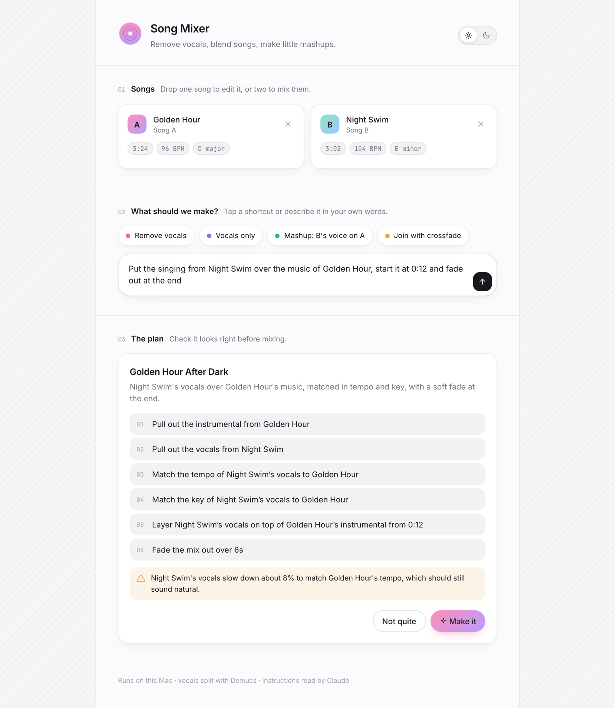
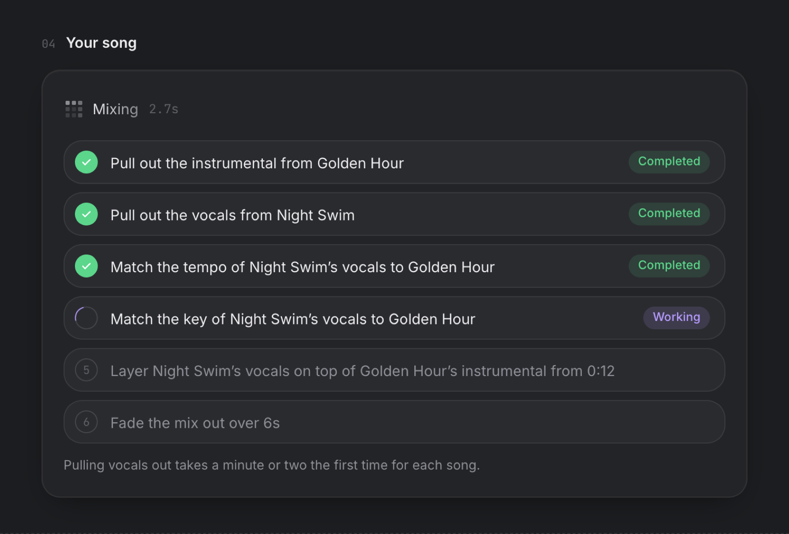
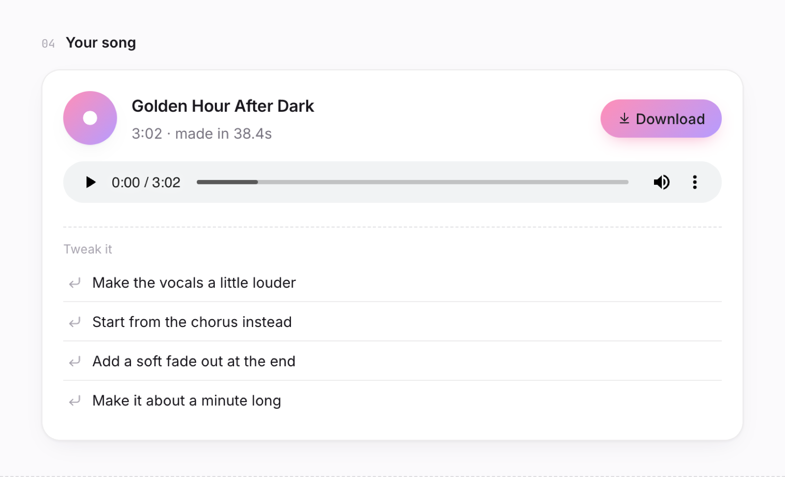
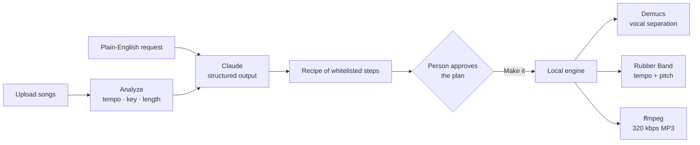

<div align="center">

# Song Mixer

**Remove vocals, blend songs, and make mashups by describing what you want in plain English.**

A local web app that pairs an AI source-separation model with an LLM planner,
so someone who has never opened a terminal can make karaoke tracks and mashups.


<br>

<picture>
  <source media="(prefers-color-scheme: dark)" srcset="docs/hero-dark.png">
  
</picture>

</div>

## Why I built it

The best tools for making mashups are either command-line ML models or paid
upload services. I wanted something a non-technical person could double-click,
drop two songs into, and talk to, while staying in control of what happens to
the audio.

## What it does

- **Remove vocals or isolate them** from any song using Meta's Demucs
  (`htdemucs_ft`) on the Mac's GPU.
- **Mash songs up**: one song's vocals over another's music, with tempo and key
  matched automatically.
- **Edit in plain English**: *"start at 0:20, fade out at the end, make the
  vocals louder"*.
- **Iterate**: "Tweak it" suggestions adjust the last mix instead of starting
  over.
- **One-tap shortcuts** for common jobs, which work with no API key.

<table>
  <tr>
    <td width="50%"></td>
    <td width="50%"></td>
  </tr>
  <tr>
    <td align="center"><sub>Live progress for every step</sub></td>
    <td align="center"><sub>Play, download, or tweak the result</sub></td>
  </tr>
</table>

## How it works



1. **Analysis.** On upload, `librosa` estimates each song's tempo (with
   half/double-time correction) and key (Krumhansl–Schmuckler profiles).
2. **Planning.** Claude gets the request plus those measurements and returns a
   recipe through a strict JSON schema. A recipe can only use eleven fixed
   operations: separate, trim, tempo, match tempo, pitch, match key, gain, fade,
   loop, overlay and concat.
3. **Review.** The recipe is shown as a numbered plan in plain English, with
   warnings when a change is likely to sound bad (for example, a vocal stretched
   more than 15% or shifted more than 3 semitones). Nothing runs until the
   person presses **Make it**.
4. **Rendering.** A small recipe engine runs the steps on NumPy arrays. Demucs
   output is cached per song, so only the first separation is slow (about 1–2
   minutes on an M-series Mac). After that, edits take seconds.

### Design decisions

- **The model plans, it doesn't execute.** Claude never runs code or touches
  files. It can only choose from a fixed set of operations, and the server
  checks that every step points at a track that exists. A strange prompt can
  produce a bad plan, but nothing worse.
- **A person approves every plan.** The plan card is the main interface, not a
  debug view. People trust the result more when they can see what will happen.
- **Audio stays on the machine.** Only the text request and song metadata
  (name, tempo, key, length) go to the API. The audio never leaves the computer.
- **Built for a non-technical user.** There's a double-click launcher, friendly
  step labels ("Match the key of Night Swim's vocals to Golden Hour"), and
  shortcuts that need no typing.

## Tech stack

| Layer | Tools |
|---|---|
| Source separation | [Demucs](https://github.com/facebookresearch/demucs) `htdemucs_ft`, PyTorch (Apple MPS) |
| Audio analysis | librosa, NumPy |
| Time-stretch / pitch-shift | [Rubber Band](https://breakfastquay.com/rubberband/) via pyrubberband |
| Planning | Claude via the Anthropic Python SDK, structured outputs |
| Backend | Flask, background job thread with step-level progress |
| Frontend | Vanilla HTML/CSS/JS, light and dark themes, no build step |

## Run it

Requires macOS (Apple Silicon recommended), [Homebrew](https://brew.sh) and
[uv](https://docs.astral.sh/uv/).

```bash
git clone https://github.com/csnmbang/song-mixer.git
cd song-mixer
./setup.sh                # Python env, ffmpeg, rubberband, dependencies
```

Add an [Anthropic API key](https://console.anthropic.com/) to `.env`
(`ANTHROPIC_API_KEY=...`) to turn on typed instructions. The shortcut buttons
work without one.

Then double-click **`Song Mixer.command`**, or run `.venv/bin/python app.py`
and open http://127.0.0.1:5055.

## Project layout

```
app.py              Flask routes: upload, plan, run, job status, files
mixer/engine.py     Analysis, Demucs separation, recipe runner, export
mixer/planner.py    Claude prompt + JSON schema, presets, plan validation
static/             The UI (index.html, style.css, app.js)
Song Mixer.command  Double-click launcher
```

## Limitations

- Mashups sound best when songs are within ~15% in tempo and ~3 semitones in
  key. Further than that, the plan warns you.
- Vocal removal can leave faint traces of the voice on dense mixes.
- Tempo and key detection are estimates and can be fooled by unusual songs.

## Notes

Only use songs you have the rights to work with. No audio is included in this
repository; the song names in the screenshots are made up.

UI patterns (approval card, task rows, prompt bar) were inspired by
[beautifului.dev](https://www.beautifului.dev/).

## License

[MIT](LICENSE)
